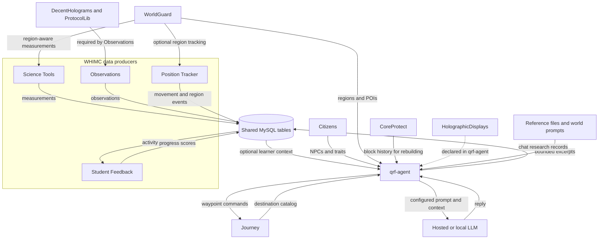
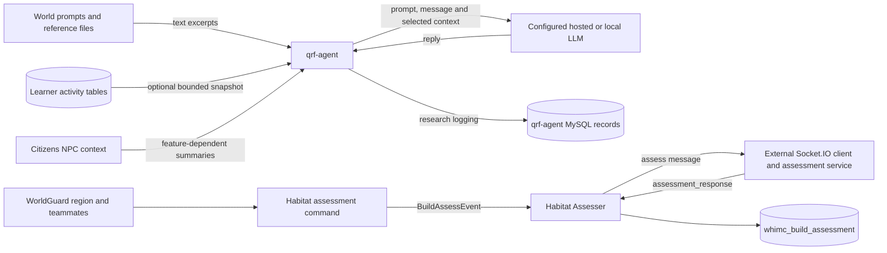

# qrf-agent relationship map draft

**For review — November 18, 2026.** Based on local source, with qrf-agent at `d73c60f`. This is a contributor orientation map, not a deployment inventory or compatibility certification. The analysis dashboard and WHIMC-Explorer are outside scope.

## How to read the map

Arrows describe the labeled flow of data, commands, or capability. Solid arrows indicate an implemented source path; dotted arrows indicate a declaration whose active use needs verification. An implemented path may still require a feature flag, particular data, or a separately installed plugin. Database arrows assume the plugins are configured to reach compatible tables in the same accessible database.

The shared tables are not one undifferentiated API. Each has its own producer and schema contract. Position Tracker also writes region events, but qrf-agent's learner-context query reads position samples rather than that region-event table.

## Direct plugins and feature dependencies

| Component | Relationship to qrf-agent | Evidence and contributor implications |
| --- | --- | --- |
| Citizens | Implemented NPC creation, traits, following, and NPC context. Effectively required at startup: qrf-agent disables itself when Citizens is absent or disabled, despite listing it under `softdepend`. | [Entry point](../../src/main/java/edu/whimc/overworld_agent/OverworldAgent.java), [manifest](../../src/main/resources/plugin.yml). Test spawn, interaction, follow, and despawn after trait/API changes. |
| QRF-Journey / runtime `Journey` | Implemented waypoint discovery through reflection, guidance catalogs, and player command dispatch; optional navigation features. | [Dialogue](../../src/main/java/edu/whimc/overworld_agent/dialoguetemplate/Dialogue.java), [catalog](../../src/main/java/edu/whimc/overworld_agent/dialoguetemplate/JourneyGuidanceCatalog.java), [navigation](../../src/main/java/edu/whimc/overworld_agent/dialoguetemplate/JourneyNavigationHelper.java), [Journey manifest](../../../QRF-Journey/bukkit/src/main/resources/plugin.yml). Method names, waypoint IDs, scopes, and command grammar are shared contracts. Test actual path start, not only successful command dispatch. |
| Science Tools | Implemented shared-table input to learner context; also a local JAR build dependency and declared soft dependency. The old `onToolUse` event listener in Dialogue is inside a block comment. | [Build dependencies](../../pom.xml), [Dialogue](../../src/main/java/edu/whimc/overworld_agent/dialoguetemplate/Dialogue.java), [producer SQL](../../../Science-Tools/src/main/java/edu/whimc/sciencetools/utils/sql/Queryer.java). Do not describe the commented listener as an active integration. |
| Observations | Implemented shared-table input to learner context; also a local JAR build dependency. It is absent from qrf-agent's soft dependency list. | [Consumer SQL](../../src/main/java/edu/whimc/overworld_agent/utils/sql/Queryer.java), [producer SQL](../../../Observations/src/main/java/edu/whimc/observations/utils/sql/Queryer.java), [build](../../pom.xml). Check active/expiration/category/text fields when changing the schema. |
| Position Tracker | Implemented indirect integration through `whimc_player_positions`; no direct Position Tracker API hookup was identified in this sweep. | [Position writer](../../../Position-Tracker/src/main/java/edu/whimc/positiontracker/sql/entries/PositionEntry.java), [consumer SQL](../../src/main/java/edu/whimc/overworld_agent/utils/sql/Queryer.java). Preserve UUID, world, timestamp, coordinate, and biome meanings. |
| Student Feedback | Reads activity tables and writes progress; qrf-agent reads those scores and reflectively ensures a feedback session exists. Student Feedback declares qrf-agent and Observations as required dependencies. | [Feedback SQL](../../../student-feedback/src/main/java/edu/whimc/feedback/utils/sql/Queryer.java), [feedback manifest](../../../student-feedback/src/main/resources/plugin.yml), [session bridge](../../src/main/java/edu/whimc/overworld_agent/OverworldAgent.java). Review the mixed dependency direction before changing load order. |
| WorldGuard | Implemented live region/POI/scene and habitat-team lookups; optional SQL POI lookup uses configured region table prefixes. Not declared in qrf-agent's manifest, although its API is a build dependency. | [Scene builder](../../src/main/java/edu/whimc/overworld_agent/dialoguetemplate/LookAtThisSceneBuilder.java), [habitat command](../../src/main/java/edu/whimc/overworld_agent/commands/HabitatAssessCommand.java), [SQL](../../src/main/java/edu/whimc/overworld_agent/utils/sql/Queryer.java). Test region IDs, world names, team membership, and absence behavior for affected features. |
| CoreProtect | Implemented history lookup in `BuildTemplate` and replay in `RebuildRunnable`; used by building/rebuilding features. Declared soft dependency and provided API. | [Template lookup](../../src/main/java/edu/whimc/overworld_agent/dialoguetemplate/models/BuildTemplate.java), [replay](../../src/main/java/edu/whimc/overworld_agent/dialoguetemplate/runnables/RebuildRunnable.java). This is an API relationship; no direct CoreProtect database read was identified here. Test only in a disposable build area. |
| DecentHolograms | Required by the local Observations manifest, alongside ProtocolLib. This is an indirect qrf-agent relationship through observation functionality. | [Observations manifest](../../../Observations/src/main/resources/plugin.yml). Verify observation creation, visibility, and deletion after hologram changes. |
| HolographicDisplays | Declared qrf-agent soft dependency and provided build API; this sweep found no direct Java API calls to it in qrf-agent. | [Manifest](../../src/main/resources/plugin.yml), [build](../../pom.xml). Treat as declared/unverified; do not equate it with DecentHolograms. Citizens YAML hologram text extraction is a separate file-reading path. |
| ProtocolLib | qrf-agent's packet-based sign menu uses its API; Observations separately declares it required. | [Sign menu](../../src/main/java/edu/whimc/overworld_agent/dialoguetemplate/SignMenuFactory.java), [Observations manifest](../../../Observations/src/main/resources/plugin.yml). Check text input submission/cancel behavior after packet/API changes. |
| WorldEdit / FAWE | Build dependencies and WorldEdit adapter use around WorldGuard. | [Build](../../pom.xml), [builder dialogue](../../src/main/java/edu/whimc/overworld_agent/dialoguetemplate/BuilderDialogue.java). The source does not establish that every listed artifact must be installed as a separate runtime plugin; verify the supported server stack. |
| Quests | Compiled dependency with direct use in Dialogue's quest-related branch; not listed in qrf-agent's soft dependencies. Distinct from Journey. | [Dialogue](../../src/main/java/edu/whimc/overworld_agent/dialoguetemplate/Dialogue.java), [build](../../pom.xml). Check that branch and its dependency guard before claiming safe absence. |
| SpeechReceiver | Declared soft dependency and local JAR dependency. Receiver initialization and old voice listener are commented out in the inspected source. | [Entry point](../../src/main/java/edu/whimc/overworld_agent/OverworldAgent.java), [Dialogue](../../src/main/java/edu/whimc/overworld_agent/dialoguetemplate/Dialogue.java). Legacy/declaration only until verified. |
| Habbitat-Assesser / runtime `WHIMC-Habitat-Assesser` | Downstream consumer of qrf-agent's `BuildAssessEvent`; queues assessment requests to a Socket.IO client/service. | [Event producer](../../src/main/java/edu/whimc/overworld_agent/commands/HabitatAssessCommand.java), [listener](../../../Habbitat-Assesser/src/main/java/edu/whimc/habitat_assesser/Listeners.java), [service bridge](../../../Habbitat-Assesser/src/main/java/edu/whimc/habitat_assesser/HabitatAssesser.java). Preserve event fields and service message contracts. |

Secondary relationships also matter: Science Tools uses WorldGuard region queries and declares Quests and Multiverse-Core optional; Position Tracker conditionally registers WorldGuard region tracking; Observations declares Multiverse-Core optional and load-before Quests. Sources: [Science Tool region lookup](../../../Science-Tools/src/main/java/edu/whimc/sciencetools/models/sciencetool/ScienceTool.java), [Science Tools manifest](../../../Science-Tools/src/main/resources/plugin.yml), [Position Tracker startup](../../../Position-Tracker/src/main/java/edu/whimc/positiontracker/PositionTracker.java), [Observations manifest](../../../Observations/src/main/resources/plugin.yml). These are not all direct qrf-agent dependencies.

## Shared data contracts

| Producer | Table or interface | Consumers in this sweep | Change checks |
| --- | --- | --- | --- |
| Science Tools | `whimc_sciencetools` | qrf-agent; Student Feedback | Measurement text/units, tool IDs, UUID, world, time; [writer](../../../Science-Tools/src/main/java/edu/whimc/sciencetools/utils/sql/Queryer.java). |
| Observations | `whimc_observations` | qrf-agent; Student Feedback | Plain/color-stripped text, categories, active status, expiration and spatial filtering; [writer](../../../Observations/src/main/java/edu/whimc/observations/utils/sql/Queryer.java). |
| Position Tracker | `whimc_player_positions` | qrf-agent; Student Feedback | Sampling, coordinates, biome/world, UUID, timestamp units; [writer](../../../Position-Tracker/src/main/java/edu/whimc/positiontracker/sql/entries/PositionEntry.java). |
| Position Tracker | `whimc_player_region_events` | Other consumers not traced here | Region membership and enter/exit semantics; not the qrf-agent learner-context input; [writer](../../../Position-Tracker/src/main/java/edu/whimc/positiontracker/sql/entries/RegionEntry.java). |
| Student Feedback | `whimc_progress` | qrf-agent | Score components including `poi_exploration`, freshness/session interpretation; [writer](../../../student-feedback/src/main/java/edu/whimc/feedback/utils/sql/Queryer.java). |
| WorldGuard SQL storage, if configured | Prefix-based region/world tables | qrf-agent POI lookup | Prefix, table accessibility, region IDs, linked world prefixes; [consumer](../../src/main/java/edu/whimc/overworld_agent/utils/sql/Queryer.java). |
| qrf-agent | `whimc_agents`, dialogue/build records, `whimc_agent_chat_*` research records | qrf-agent and research consumers not traced here | Migration compatibility and identifiers; [queries](../../src/main/java/edu/whimc/overworld_agent/utils/sql/Queryer.java), [migrations](../../src/main/java/edu/whimc/overworld_agent/utils/sql/migration/schemas). No dashboard interface is asserted. |

For learner context, qrf-agent uses its configured `mysql:` connection. A plugin being installed does not establish that its data is visible through that connection. Missing tables, stale data, or incompatible schemas need their own diagnosis. Latest progress and movement summaries can have different freshness; neither is a replacement for the player's live location.

## External services and content

- **Hosted/local model API:** implemented providers include OpenAI, Gemini, and OpenAI-compatible endpoints. Configuration selects the provider and context features. Prompt/context changes can alter the data sent outside the Minecraft server; document the actual enabled context. Sources: [provider factory](../../src/main/java/edu/whimc/overworld_agent/dialoguetemplate/models/llm/LlmProviderFactory.java), [learner context](../../src/main/java/edu/whimc/overworld_agent/llm/context/LearnerActivityContextProvider.java), [configuration](../../src/main/resources/config.yml).
- **Reference content:** world prompt YAML and configured reference folders supply bounded file excerpts. This path is not a vector database or an automatic web crawler. See the existing [RAG documentation](../llm-rag.md) and [file reader](../../src/main/java/edu/whimc/overworld_agent/dialoguetemplate/models/llm/RagDocumentReader.java). Review content ownership and field selection as interface changes.
- **Local classifier:** the bundled `model.pmml` and PMML-backed chatbot provide a separate local dialogue path. Not every dialogue turn makes an HTTP request. See [Chatbot](../../src/main/java/edu/whimc/overworld_agent/dialoguetemplate/models/Chatbot.java) and [README](../../README.md).
- **Habitat service:** the plugin bridge confirms Socket.IO messages and stored results; this sweep does not verify the external assessment engine, routing script, availability, or deployed message compatibility. See [Habitat Assesser](../../../Habbitat-Assesser/src/main/java/edu/whimc/habitat_assesser/HabitatAssesser.java).
- **NPC skin URLs:** optional custom player skins use Citizens' Mineskin integration to resolve an HTTPS image URL. This is a separate external content path from LLM reference files. See [skin URL helper](../../src/main/java/edu/whimc/overworld_agent/utils/CitizensSkinUrls.java).

## Source snapshot

| Local repository | HEAD at inspection |
| --- | --- |
| qrf-agent | `d73c60f` |
| QRF-Journey | `a2b9133` |
| Science-Tools | `cfe7e31` |
| Observations | `3d360ab` |
| Position-Tracker | `4a939c7` |
| student-feedback | `c7a4be5` |
| Habbitat-Assesser | `9f3acea` |

Evidence links point to local working-tree files. Science-Tools had a pre-existing tracked modification at inspection, so its HEAD alone does not freeze the inspected working tree. Source links to sibling repositories assume this workspace layout; replace them with canonical repository permalinks before publishing centrally. No live database records, credentials, or deployed plugin configuration were needed for this draft.

## Suggested integration checks

Use synthetic learners and a development database. Record the plugin versions/configuration used rather than assuming all integrations are enabled.

| Change area | Smallest useful end-to-end check |
| --- | --- |
| Science Tools / Observations / Position Tracker schema or writes | Generate one synthetic record through the producer, confirm qrf-agent reads and summarizes it with activity context enabled; check Student Feedback too. For observations, include expired/inactive and nearby peer cases. |
| Journey IDs, scopes, commands or reflection | Select a known destination through agent guidance and verify a visible route starts; test same-world filtering, duplicate display names, and absent Journey. |
| WorldGuard / region naming | Test POI discovery and habitat teammate selection. If SQL POIs are enabled, test that path separately from live API lookup. |
| Citizens / ProtocolLib | Spawn, converse, submit/cancel text input, follow, teleport and despawn; test Citizens absence during startup. |
| CoreProtect / rebuilding | Reconstruct a tiny known block history in a disposable area; exercise missing/disabled API and empty history. |
| Holograms | Verify Observations with DecentHolograms and ProtocolLib. Investigate qrf-agent's HolographicDisplays declaration separately. |
| LLM / context / reference files | Use synthetic context to verify which fields leave the server; test no provider, timeout, empty context, and logging with keys redacted. |
| BuildAssessEvent / habitat service | Send one synthetic request through the event and service bridge; verify response matching, stored result, and disconnected-service behavior. |

These are proposed checks, not claims that the current code passes them.

## Questions to resolve before adoption

1. Which local checkout and release is canonical for each plugin? `QRF-Journey` has runtime name `Journey`; folder names, Maven artifacts and plugin names are not interchangeable.
2. Which plugins, database schemas, model providers and optional features are actually deployed? No live server configuration or learner records were inspected.
3. Which declared dependencies are still necessary? Citizens is behaviorally required; WorldGuard/Quests/Observations have manifest gaps; HolographicDisplays and SpeechReceiver need usage decisions. Investigate separately rather than changing manifests from this map alone.
4. Student Feedback requires qrf-agent, while qrf-agent lists Student Feedback as a soft dependency. Verify resolution and supported startup behavior on the intended server version.
5. Who owns each shared schema and external service contract, and which versions must remain compatible?
6. Which downstream analysis consumers exist? Their owners should review schema changes, but their implementation is intentionally outside this draft.
